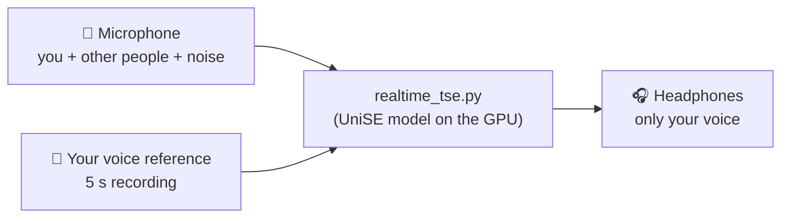
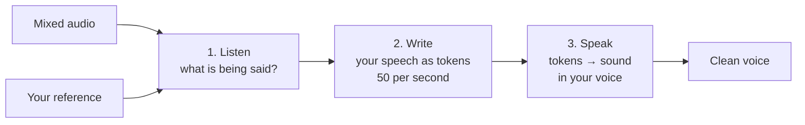
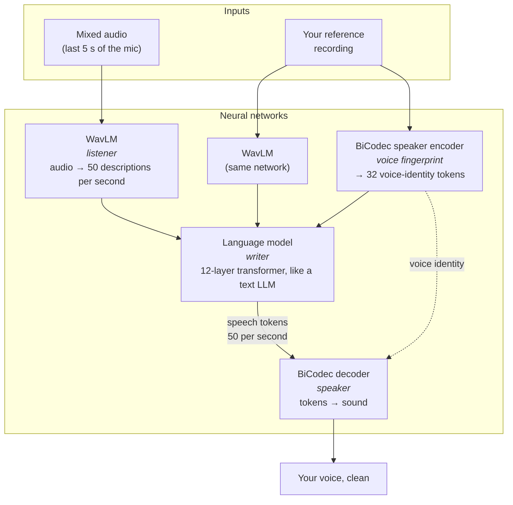
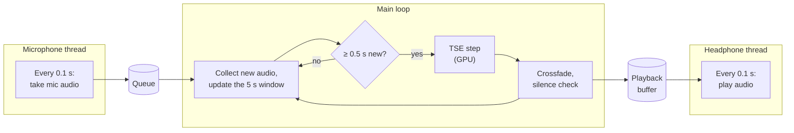
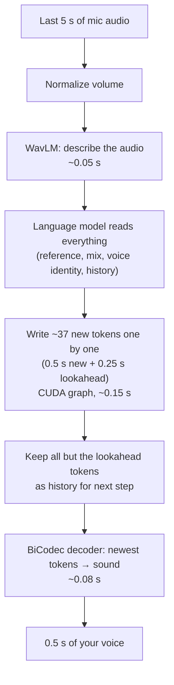

# Real-time Target Speaker Extraction

**Talk into a microphone while other people are talking, and hear only your own voice in your headphones, about 1.3 seconds later.**

You give the program a short recording of your voice (the *reference*). From then on it listens to the microphone, picks out your voice from everything else (other speakers, background noise), and plays a clean version of just your voice.

This is called **Target Speaker Extraction (TSE)**. The project runs the research model **UniSE** ([paper](https://arxiv.org/abs/2510.20441), [weights](https://huggingface.co/QuarkAudio/QuarkAudio-UniSE)) live on a laptop GPU. The model was built to process recorded files; the code here makes it work on a live microphone.



---

## Contents

1. [Quick start](#1-quick-start)
2. [How it works, in plain words](#2-how-it-works-in-plain-words)
3. [The model: three neural networks](#3-the-model-three-neural-networks)
4. [Making it live: the sliding window](#4-making-it-live-the-sliding-window)
5. [Where the 1.3 s of delay comes from](#5-where-the-13-s-of-delay-comes-from)
6. [Making it fast enough](#6-making-it-fast-enough)
7. [Inside the program](#7-inside-the-program)
8. [All options](#8-all-options)
9. [Project files](#9-project-files)
10. [Measured results](#10-measured-results)
11. [Limitations](#11-limitations)
12. [Troubleshooting](#12-troubleshooting)
13. [Glossary](#13-glossary)
14. [Credits and license](#14-credits-and-license)

---

## 1. Quick start

### What you need

| | |
|---|---|
| **Computer** | Windows (tested on Windows 11). Linux should work but is untested. |
| **GPU** | NVIDIA GPU with at least 4 GB of memory (tested on an RTX 3050 Laptop GPU). Without a GPU it runs, but far too slowly for live use. |
| **Disk** | About 3.5 GB for the model files. |
| **Audio** | **Headphones** (essential: with speakers, the mic hears the output and the voice loops back) and a microphone. |
| **Python** | Python 3.10, for example through [Miniconda](https://docs.conda.io/en/latest/miniconda.html). |

### Setup (once)

```powershell
# 1. Create a Python environment
conda create -n unise python=3.10
conda activate unise

# 2. Go to the code
cd audio-extraction-project\QuarkAudio-UniSE

# 3. Install PyTorch with GPU support first, then everything else
pip install torch==2.14.0+cu126 --index-url https://download.pytorch.org/whl/cu126
pip install -r requirements.txt

# 4. Download the model files (~2.9 GB) into ./checkpoints
python download_models.py
```

A fourth model (WavLM, ~380 MB) downloads automatically the first time you run the program.

### Run it

```powershell
# Find the numbers of your microphone and headphones
python realtime_tse.py --list_devices

# First time: record 5 s of your voice (only you talking, quiet room), then it goes live
python realtime_tse.py --record_enroll 5 --input_device <mic number> --output_device <headphones number>

# Later: reuse the saved recording
python realtime_tse.py --enroll enroll_recorded.wav
```

Press **Ctrl+C** to stop. On startup it prints `Using device: cuda`; if it says `cpu`, PyTorch can't see your GPU (see [Troubleshooting](#12-troubleshooting)).

> The default device numbers in `realtime_tse.py` (mic `1`, headphones `7`) belong to the laptop this was developed on. Yours will differ: pass `--input_device` / `--output_device`, or change the defaults at the bottom of the file.

### Try it without a microphone

The `AudioSamples/TSE` folder has test files: `noisy/` holds two people talking at once, `ref/` holds a reference for the target speaker in each.

```powershell
python realtime_tse.py --enroll AudioSamples/TSE/ref/1.wav --input_wav AudioSamples/TSE/noisy/1.wav --output_wav out.wav --no_play
```

This feeds the file in at real-time speed, as if it were a microphone, and saves the result to `out.wav`.

---

## 2. How it works, in plain words

Most noise-removal tools are **filters**: they take the recording and turn down the parts that aren't you.

UniSE works differently. It is **generative**, like a chatbot, but for speech:

1. It **listens** to the microphone audio and works out what is being said and by whom.
2. It **writes** your speech as a sequence of small codes called *tokens* (50 per second), one after another, the way a chatbot writes words.
3. It **turns the tokens back into sound**, in your voice.

So the output is not your original audio with the rest removed; it is your speech **re-created** from scratch. That is why it can remove another person talking right over you, which filters struggle with. It also explains some quirks: the output never matches the input sample-for-sample, and when the model is unsure it can produce mumbles.



---

## 3. The model: three neural networks

UniSE is three neural networks working together, about 345 million parameters in total.



| Network | Its job | What it is | Size | Made by |
|---|---|---|---|---|
| **WavLM** | Turns audio into a description of the speech, 50 times per second | Transformer | ~95M parameters | Microsoft (`microsoft/wavlm-base-plus`) |
| **Language model** | Reads the descriptions of the mix and of your reference, then writes your speech as tokens | Llama-style transformer: 12 layers, width 512 | ~100M parameters | UniSE authors |
| **BiCodec** | Its *speaker encoder* turns your reference into 32 voice-identity tokens; its *decoder* turns speech tokens back into a 16 kHz waveform | Convolutional audio codec | ~150M parameters | Spark-TTS authors |

The model files also contain a 315M-parameter network (wav2vec2) that BiCodec needs during training. It is loaded but never used while running.

### What the language model reads

Like a chatbot, the language model reads one long sequence and then continues it. Each step it reads:

```
┌──────┬──────────────────────┬──────────────────────────┬────────────────────┬────────────────────┬──────────────────┐
│ task │ your reference       │ the mic audio            │ your voice-identity│ your speech so far │ NEW: your speech │
│ "TSE"│ (WavLM description)  │ (WavLM description, 5 s) │ (32 tokens)        │ (tokens, history)  │ (tokens it writes│
│      │                      │                          │                    │                    │  now, one by one)│
└──────┴──────────────────────┴──────────────────────────┴────────────────────┴────────────────────┴──────────────────┘
 ◄────────────────────────── given to the model ──────────────────────────────────────────────────► ◄── generated ──►
```

---

## 4. Making it live: the sliding window

The model was trained on **5-second clips**: give it 5 s of mixed audio, and it writes 5 s of clean speech. Used that way on a live mic, you would wait 5 s for a clip to fill, then wait for it to process, then hear it: 6–7 s of delay.

Instead, the program **slides** a 5 s window forward every 0.5 s and only writes the speech that is new:

```
Time ─────────────────────────────────────────────────────────────────►

Step 1  [══════════ 5 s window ═══════════]
                                   ├hop┤ ← 0.5 s of new audio

Step 2       [══════════ 5 s window ═══════════]
             reuse tokens from step 1 ───► │new│
                                           written now

Step 3            [══════════ 5 s window ═══════════]
                  reuse tokens from step 2 ───► │new│
```

Three ideas make this work:

**1. Reuse history.** Most of each window was already handled in the previous step. Those tokens are fed back in as "your speech so far", so each step only writes about 25 new tokens instead of 250. This is also how the model was trained (it always saw the correct earlier tokens while learning), so quality holds up.

**2. Look ahead.** When the model writes the token for "right now", it hasn't heard what comes next, so the newest moment is the hardest to get right. Was that sound you, or the other person starting to speak? So each step also writes 0.25 s further than it plays. Those last tokens are thrown away and rewritten next step, once more audio has arrived. Everything you hear was decided with at least 0.25 s of audio after it.

```
                         window end
                              │
 ... history (reused) │ played now │ lookahead │
                      │  0.5 s     │  0.25 s   │
                      └─ kept as history next step
                                   └─ rewritten next step with more context
```

**3. Voice identity from your reference.** The 32 voice-identity tokens come straight from your recording, not from the live audio. So it doesn't matter who talks first. In tests this was the single biggest quality improvement.

Each step also takes **whatever audio arrived while the previous step ran**. If a step is ever slow, the next one simply handles a bigger piece. Audio never piles up and nothing is skipped. Consecutive pieces are joined with a 40 ms crossfade so there are no clicks.

---

## 5. Where the 1.3 s of delay comes from

| Part | Time | Why |
|---|---|---|
| Collecting new audio (hop) | 0.5 s | Each step waits for 0.5 s of new audio. Shorter hops measurably hurt quality. |
| Processing one step | ~0.3 s | On an RTX 3050 Laptop GPU |
| Lookahead | 0.25 s | Output is held back until the model has heard 0.25 s past it |
| Crossfade | 0.04 s | Joins consecutive pieces smoothly |
| Microphone and headphone buffers | ~0.2 s | Windows audio |
| **Total** | **≈ 1.3 s** | |

Startup takes longer, once: the first 5 s window has to fill and be fully processed, so the first sound comes about 7 s after it says it's running.

---

## 6. Making it fast enough

Out of the box, the model took about **15 s** on the CPU, and **10 s** on the GPU, to process 5 s of audio, far too slow to keep up. Now one 0.5 s step takes about **0.3 s**:

| Technique | What it does | Effect |
|---|---|---|
| **GPU** | Runs the networks on the graphics card | 15 s → 10 s |
| **CUDA graphs** | Writing one token used to launch ~500 tiny GPU jobs one by one, and on Windows each launch has overhead. The whole token step is recorded once and replayed as a single job. | Writing speed ~5× faster; output identical |
| **Sliding window with history** | Writes ~25 new tokens per step instead of 250 | Each step is a fraction of the work |
| **Decode only the end** | Turns only the newest tokens (plus a little context) back into sound, not the whole window. The decoder only looks at nearby tokens, so the output is identical. | Decoding 0.15 s → 0.08 s |
| **Half precision (fp16)** | Runs the language model with 16-bit numbers instead of 32-bit | Writing 0.23 s → 0.14 s; quality unchanged in tests |

---

## 7. Inside the program

`realtime_tse.py` runs three things at the same time:



And this is what one **TSE step** does (`TSE.__call__` in the code):



### Main pieces of the code

| In `realtime_tse.py` | What it does |
|---|---|
| `load_model()` | Builds the networks and loads the downloaded weights onto the GPU |
| `prepare_enroll()` | Cuts or loops your reference to exactly 5 s and normalizes its volume |
| `TSE` | One extraction step (above). Holds the history tokens between steps. |
| `TSE._build()` | Sets up the model's memory and records the CUDA graph for writing one token |
| `TSE._generate()` | Feeds in the sequence, then writes the new tokens |
| `Player` | Playback buffer between the main loop and the headphones |
| `main()` | Reads options, records or loads the reference, opens audio devices, runs the loop |

---

## 8. All options

| Option | Default | What it does |
|---|---|---|
| `--enroll FILE` | | Use this recording of your voice as the reference |
| `--record_enroll N` | | Record N seconds of your voice from the mic first (saved as `enroll_recorded.wav`) |
| `--save_enroll FILE` | `enroll_recorded.wav` | Where to save a recorded reference |
| `--hop S` | `0.5` | Minimum seconds of new audio per step. Smaller = less delay but worse quality. |
| `--lookahead S` | `0.25` | Seconds the model hears past each output before committing it. `0` = less delay, worse quality. |
| `--window S` | `5.0` | Seconds of audio the model sees. It was trained on 5. |
| `--prebuffer S` | `0.25` | Seconds of output queued before playback starts |
| `--silence_rms X` | `0.003` | Input quieter than this is output as silence |
| `--gain X` | `1.0` | Output volume multiplier |
| `--fp32` | off | Run the language model in 32-bit (slower) instead of 16-bit |
| `--input_device N` | `1` | Microphone number (see `--list_devices`) |
| `--output_device N` | `7` | Headphones number (see `--list_devices`) |
| `--list_devices` | | Print all audio devices and exit |
| `--input_wav FILE` | | Read this file at real-time speed instead of the mic |
| `--output_wav FILE` | | Also save the extracted voice to this file |
| `--save_input FILE` | | Save what the mic heard |
| `--no_play` | off | Don't play anything (useful with `--input_wav`) |
| `--threads N` | `4` | CPU threads |
| `--config FILE` | `./conf/config.yaml` | Model settings file |

---

## 9. Project files

```
audio-extraction-project/
├── README.md                     ← this file
├── LICENSE                       ← Apache 2.0
├── .gitignore                    ← keeps model files and your voice recording out of git
└── QuarkAudio-UniSE/
    ├── realtime_tse.py           ← THE PROGRAM: everything live happens here
    ├── download_models.py        ← downloads the model files into checkpoints/
    ├── requirements.txt          ← Python packages and exact versions
    ├── conf/
    │   └── config.yaml           ← shape of the language model + where the weights are
    ├── model/                    ← the neural network code (from the UniSE authors)
    │   ├── model.py              ←   puts WavLM, the language model and BiCodec together
    │   ├── llm/                  ←   the language model (Llama-style transformer)
    │   └── bicodec/              ←   the BiCodec audio codec (from Spark-TTS)
    ├── AudioSamples/TSE/         ← test files: noisy/ (two speakers) and ref/ (references)
    ├── checkpoints/              ← model weights, downloaded, NOT in git (~2.9 GB)
    │   ├── epoch=20-step=109367.ckpt   ← UniSE language model weights
    │   ├── BiCodec/                    ← BiCodec weights + its settings
    │   ├── wav2vec2-large-xlsr-53/     ← needed to load BiCodec, unused at runtime
    │   └── config.yaml                 ← BiCodec audio settings
    └── enroll_recorded.wav       ← your voice reference, NOT in git
```

**Don't edit the numbers in `checkpoints/BiCodec/config.yaml` or the `llm_config` part of `conf/config.yaml`.** They describe the shape of the networks and must match the downloaded weights exactly; changing them breaks loading or produces garbage.

---

## 10. Measured results

Quality was measured on the sample clip (`AudioSamples/TSE/noisy/1.wav`, repeated 3× to make 15 s) against the known clean voice. A generative model never reproduces the waveform exactly, so these measures compare what matters instead:

- **Follows target**: how closely the output's loudness rises and falls with the target speaker (1.0 = perfectly). Higher is better.
- **Follows other speaker**: the same, against the other speaker. Lower is better.
- **Content match**: how similar the speech content is to the clean target, per WavLM. Higher is better.

| Version | Follows target ↑ | Follows other speaker ↓ | Content match ↑ |
|---|---|---|---|
| The mixed input (doing nothing) | 0.757 | 0.648 | 0.691 |
| Sliding window, voice identity guessed from live audio | 0.818 | 0.318 | 0.864 |
| + voice identity from your reference | 0.937 | 0.193 | 0.892 |
| **+ 0.25 s lookahead (current)** | **0.955** | **0.152** | **0.912** |

In a harder test, where only the other speaker talks for the first 5 s, the current version scored 0.947 / 0.167 / 0.900.

These numbers come from one short clip, so treat them as a guide; real conversations may behave differently.

---

## 11. Limitations

- **About 1.3 s of delay.** The model needs to hear a stretch of audio before it can decide; this design can't get near-instant. That would need a different kind of model, built for streaming.
- **16 kHz audio.** BiCodec works at telephone-like quality, so voices sound slightly muffled.
- **It re-creates speech.** When the model is unsure (very noisy audio, words in a language it wasn't trained on), it can produce mumbles or wrong-sounding syllables instead of silence.
- **Your reference matters a lot.** The voice identity comes straight from it. Record it in a quiet room with only you talking. Only the first 5 s are used.
- **GPU needed.** About 2.7 GB of GPU memory. Other GPU-heavy programs (e.g. NVIDIA Broadcast) can push it over the limit on a 4 GB card.
- **Occasional tiny gaps** in playback are possible if a step runs late. Raise `--prebuffer` if you hear them.
- **Files fed with `--input_wav`** lose their last 0.25 s (the lookahead). Live use is unaffected.

---

## 12. Troubleshooting

| Problem | Fix |
|---|---|
| Says `Using device: cpu` | PyTorch can't see the GPU. Reinstall the GPU build: `pip install --force-reinstall --no-deps torch==2.14.0+cu126 --index-url https://download.pytorch.org/whl/cu126` |
| `AttributeError: ... '_update_causal_mask'` | Wrong `transformers` version. `pip install transformers==4.46.3` (newer versions removed something the model code uses). |
| Can't find `checkpoints/...` | Run `python download_models.py` from inside `QuarkAudio-UniSE/`. |
| No sound, or the wrong mic/headphones | Run `--list_devices` and pass `--input_device` / `--output_device`. Device numbers change when you plug devices in or out. |
| Echo or a growing howl | Use headphones, not speakers. |
| Sounds unclear or like someone else | Re-record your reference in a quiet room, only you talking. Make sure you use the default `--hop 0.5`. |
| Lines saying `step took` more than the hop | The GPU can't keep up. Close other GPU programs, or raise `--hop`. |
| Out of GPU memory | Close other GPU programs (NVIDIA Broadcast, games, browsers with GPU acceleration). |

---

## 13. Glossary

| Term | Meaning |
|---|---|
| **TSE** | Target Speaker Extraction: pulling one known person's voice out of a mix |
| **Reference / enrollment** | A short, clean recording of the target voice, telling the model whose voice to extract |
| **Neural network** | A program that learned its behavior from examples rather than being written by hand |
| **Transformer** | The type of neural network behind ChatGPT and most modern AI. WavLM and the language model are transformers. |
| **Token** | A small code standing for a slice of sound. Here: 50 tokens per second, each out of 8,192 possible codes. |
| **Codec** | Something that turns sound into tokens and back. Here: BiCodec. |
| **Window** | The stretch of recent audio the model looks at each step (5 s) |
| **Hop** | How much new audio arrives between steps (0.5 s) |
| **Lookahead** | How far past the output the model has already heard before committing it (0.25 s) |
| **GPU** | Graphics card; runs neural networks far faster than the main processor |
| **CUDA graph** | A recording of a series of GPU jobs that can be replayed as one, cutting overhead |
| **fp16 / fp32** | 16-bit or 32-bit numbers. 16-bit is faster and usually just as good. |

---

## 14. Credits and license

- **UniSE**: Haoyin Yan, Chengwei Liu, Shaofei Xue, Xiaotao Liang, Zheng Xue. *UniSE: A Unified Framework for Decoder-only Autoregressive LM-based Speech Enhancement*, 2025. [arXiv:2510.20441](https://arxiv.org/abs/2510.20441). Model weights: [QuarkAudio/QuarkAudio-UniSE](https://huggingface.co/QuarkAudio/QuarkAudio-UniSE).
- **BiCodec**: from [Spark-TTS](https://huggingface.co/SparkAudio/Spark-TTS-0.5B) by SparkAudio.
- **WavLM**: [microsoft/wavlm-base-plus](https://huggingface.co/microsoft/wavlm-base-plus) by Microsoft.

The model code in `model/` comes from the original authors; the live-streaming program `realtime_tse.py` was written for this project. Licensed under Apache 2.0 (see `LICENSE`).
